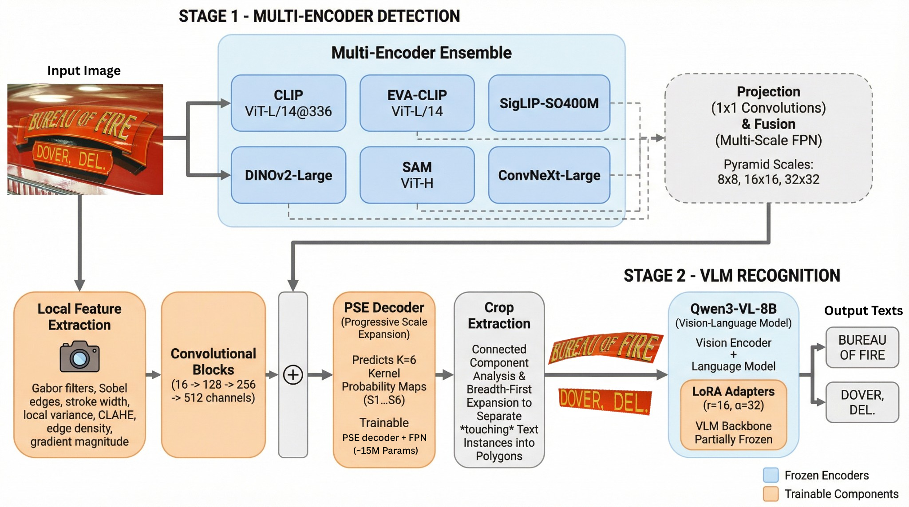

# MEVL-STP: Curved Text Detection and Recognition

<p align="center">
  
</p>

> **State-of-the-art curved text spotting** through multi-encoder feature fusion and vision-language model recognition. Achieves 92.0% detection F1 and 85.9% end-to-end H-mean on CTW1500 without synthetic pretraining.

📄 **Paper:** MEVL-STP: Multi-Encoder and Vision Language Model for Arbitrarily Shaped Scene Text Spotting (ECCV 2026)

---

## Key Features

- **Six Frozen Encoders**: CLIP, DINOv2, SigLIP, EVA-CLIP, SAM, ConvNeXt — spanning semantic, spatial, and texture feature spectra
- **Hierarchical FPN**: Trainable lateral connections with SE/CBAM channel attention (~15M parameters)
- **Deep-Supervision PSE**: 6-kernel Progressive Scale Expansion with auxiliary losses
- **LoRA-Adapted VLM**: Qwen3-VL-8B fine-tuned on polygon crops (r=16, α=32, ~0.2% parameters)
- **Training**: CTW1500 dataset only, no synthetic data

---

## CTW1500 Benchmark Results

### Detection Performance (IoU ≥ 0.5)

| Method | Venue | Year | Precision | Recall | F1 |
|--------|-------|------|-----------|--------|----|
| DPText-DETR | AAAI | 2023 | 91.7 | 86.2 | 88.8 |
| DeepSolo* | CVPR | 2023 | 93.2 | 85.0 | 88.9 |
| LRANet++* | arXiv | 2025 | 92.8 | 88.1 | 90.3 |
| **MEVL-STP** | ECCV | 2026 | 90.3 | **93.8** | **92.0** |

### End-to-End Spotting (H-mean %)

| Method | None | Full |
|--------|------|------|
| DeepSolo* | 64.2 | 81.4 |
| ESTextSpotter* | 64.9 | 83.9 |
| LRANet++* | 70.7 | 85.2 |
| **MEVL-STP** | **75.2** | **85.9** |

*\* denotes use of synthetic training data*

> **MEVL-STP** achieves first place on CTW1500 end-to-end spotting among methods without synthetic pretraining.

For additional results on Total-Text and ICDAR 2015, see the paper

---

## Installation

### Requirements
- Python >= 3.10
- PyTorch >= 2.1.0
- CUDA >= 11.8

```bash
git clone https://github.com/doubleblind-afk/MEVL-STP.git
cd MEVL-STP
pip install -r requirements.txt
```

---

## CTW1500 Dataset

Download CTW1500 from the [official repository](https://github.com/Yuliang-Liu/Curve-Text-Detector) and organize as:

```
data/ctw1500/
├── train_images/              (1,000 curved text images)
├── test_images/               (500 images)
├── ctw1500_train_labels/      (XML annotations, 14-point polygons)
└── ctw1500_test_labels/
```

Configuration files for Total-Text and ICDAR 2015 are provided in `configs/` for reference.

---

## Pretrained Models

| Component | Description | Download |
|-----------|-------------|----------|
| Detection Model | Trained on CTW1500 (92.0% F1) | [Google Drive](https://drive.google.com/file/d/15aThfgnJbkkW792bMM3wBvBmvRd_6oA8/view?usp=sharing) |
| VLM LoRA Adapter | CTW1500 recognition (94.23% accuracy) | [Google Drive](https://drive.google.com/drive/folders/1LWsQpr9DDn03A0Elp2bRzdQkW5v-h4IU?usp=sharing) |

**Base models** are auto-downloaded from HuggingFace on first run:
- Six frozen encoders (CLIP, DINOv2, SigLIP, EVA-CLIP, SAM, ConvNeXt)
- Qwen3-VL-8B-Instruct base model

---

## Quick Start

### Training

Train the detection model on CTW1500:
```bash
python tools/train_detection.py --config configs/ctw1500_det.yaml
```

Fine-tune VLM recognition with LoRA:
```bash
python tools/train_recognition.py \
  --config configs/ctw1500_rec.yaml \
  --crop-dir data/ctw1500/crops/
```

End-to-end phased training:
```bash
python tools/train_e2e.py --config configs/ctw1500_e2e.yaml
```

### Evaluation

Evaluate detection:
```bash
python tools/eval_detection.py \
  --config configs/ctw1500_det.yaml \
  --checkpoint checkpoints/ctw1500_det_best.pth
```

Evaluate end-to-end spotting:
```bash
python tools/eval_e2e.py \
  --det-checkpoint checkpoints/ctw1500_det_best.pth \
  --rec-checkpoint checkpoints/ctw1500_vlm_lora/ \
  --config configs/ctw1500_e2e.yaml
```

### Inference

Run on custom images:
```bash
python tools/inference.py \
  --image path/to/image.jpg \
  --det-checkpoint checkpoints/ctw1500_det_best.pth \
  --rec-checkpoint checkpoints/ctw1500_vlm_lora/ \
  --output results/
```

---

## Model Architecture

<p align="center">
  
</p>

### Two-Stage Pipeline

**Stage 1: Multi-Encoder Detection**
1. Six frozen vision encoders extract complementary features (semantic, spatial, texture)
2. Hierarchical FPN with SE/CBAM attention fuses multi-resolution features
3. PSE decoder with deep supervision produces instance-level polygon masks
4. 16-channel handcrafted local features refine boundary vertices

**Stage 2: VLM Recognition**
1. Polygon crops isolate curved text from background clutter
2. Qwen3-VL-8B adapted via LoRA (r=16, α=32) on CTW1500 crops
3. Selective loss on assistant tokens only
4. 4 epochs training achieves 94.23% recognition accuracy

### Encoder Configuration

| Encoder | Type | Spectrum | Resolution |
|---------|------|----------|------------|
| CLIP ViT-L/14 | Vision-Language | Semantic | 336×336 |
| DINOv2-Large | Self-Supervised | Spatial | 518×518 |
| SigLIP-SO400M | Vision-Language | Semantic | 384×384 |
| EVA-CLIP ViT-L/14 | Vision-Language | Semantic | 224×224 |
| SAM ViT-H | Segmentation | Spatial | 1024×1024 |
| ConvNeXt-Large | CNN | Texture | 384×384 |

---

## Project Structure

```
MEVL-STP/
├── configs/
│   ├── ctw1500_det.yaml       # Detection config (CTW1500)
│   ├── ctw1500_rec.yaml       # VLM LoRA config (CTW1500)
│   ├── ctw1500_e2e.yaml       # End-to-end config (CTW1500)
│   ├── totaltext_det.yaml     # (reference)
│   └── icdar2015_det.yaml     # (reference)
├── mevlstp/
│   ├── models/
│   │   ├── encoders.py        # Six frozen encoder wrappers
│   │   ├── fpn.py             # Hierarchical FPN + attention
│   │   ├── pse_decoder.py     # PSE with deep supervision
│   │   ├── local_features.py  # Gabor, Sobel, SWT, CLAHE
│   │   ├── vlm_recognizer.py  # Qwen3-VL + LoRA
│   │   └── pipeline.py        # Full spotting pipeline
│   ├── datasets/
│   │   └── ctw1500.py         # CTW1500 data loader
│   ├── evaluation/
│   │   ├── detection_metrics.py  # Polygon IoU, P/R/F1
│   │   └── e2e_metrics.py        # E2E with NED
│   └── utils/
│       ├── pse_decode.py      # PSE instance separation
│       └── visualize.py       # Result visualization
├── tools/
│   ├── train_detection.py
│   ├── train_recognition.py
│   ├── eval_detection.py
│   ├── eval_e2e.py
│   └── inference.py
└── scripts/
    ├── train_ctw1500.sh
    └── eval_ctw1500.sh
```

---

## Citation

```bibtex
@inproceedings{mevlstp2026,
  title={MEVL-STP: Multi-Encoder and Vision Language Model for Arbitrarily Shaped Scene Text Spotting},
  author={Anonymous},
  booktitle={Proceedings of the European Conference on Computer Vision (ECCV)},
  year={2026}
}
```

---

## Acknowledgements

This project builds upon the following open-source works:
- [CLIP](https://github.com/openai/CLIP) (OpenAI)
- [DINOv2](https://github.com/facebookresearch/dinov2) (Meta)
- [SigLIP](https://github.com/google-research/big_vision) (Google)
- [SAM](https://github.com/facebookresearch/segment-anything) (Meta)
- [ConvNeXt](https://github.com/facebookresearch/ConvNeXt) (Meta)
- [Qwen3-VL](https://github.com/QwenLM/Qwen2.5-VL) (Alibaba)
- [PSENet](https://github.com/whai362/PSENet)

## License

This project is released under the [Apache 2.0 License](LICENSE).
